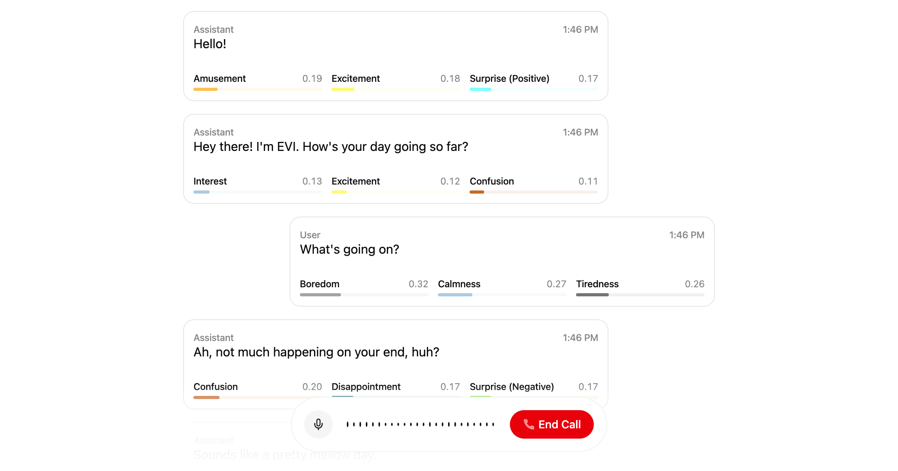

  
  <h1>EVI Next.js App Router Example</h1>

## Overview

This project features a sample implementation of Hume's [Empathic Voice Interface](https://hume.docs.buildwithfern.com/docs/empathic-voice-interface-evi/overview) using Hume's React SDK. Here, we have a simple EVI that uses the Next.js App Router.

## Project deployment

Click the button below to deploy this example project with Vercel:

Below are the steps to completing deployment:

1. Create a Git Repository for your project.
2. Provide the required environment variables. To get your API key and Client Secret key, log into the portal and visit the [API keys page](https://beta.hume.ai/settings/keys).

## Support

If you have questions, require assistance, or wish to engage in discussions pertaining to this starter template, [please reach out to us on Discord](https://link.hume.ai/discord).

---

## Ownership and licence

Copyright (c) 2026 **Mohammed Jabir Hussain Shaik** ([@thejabirhussain](https://github.com/thejabirhussain)). **All rights reserved.**

This is proprietary work, published for viewing and evaluation only. Copying, reusing, modifying, redistributing, using it to train AI models, or presenting any part of it as your own is **not permitted** without written permission. See [LICENSE](LICENSE). Permission requests: thejabirhussain@gmail.com
